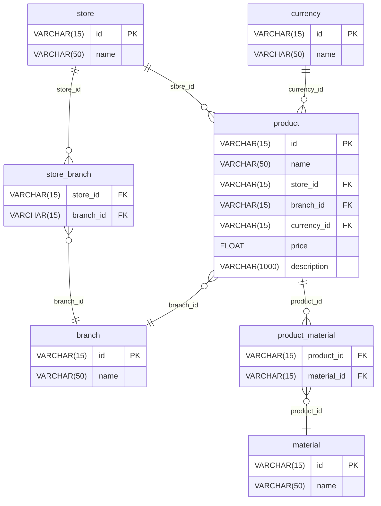
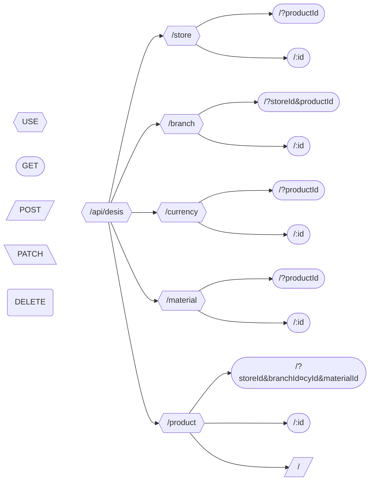

# Sistema de Registro de Productos - Evaluación Desis

Este proyecto es un sistema web para el registro de productos que valida y almacena datos utilizando HTML, CSS puro, JavaScript (AJAX) y PHP nativo conectado a una base de datos MySQL/MariaDB.

## Versiones del Entorno

- PHP: 8.2.12

- Base de Datos (MySQL/MariaDB): 10.4.32-MariaDB

## Pasos para instalar y ejecutar el proyecto

1. Clonar el repositorio
   - Clona este repositorio de GitHub en tu máquina local. Si deseas mantenerlo en tu carpeta de GitHub personal, asegúrate de crear un enlace simbólico en XAMPP para que Apache pueda leerlo. (Ejemplo en CMD como administrador: `mklink /D "C:\xampp\htdocs\desis" "C:\Ruta\A\Tu\Repositorio"`)
   - Alternativamente, puedes clonar el proyecto directamente dentro de la carpeta `C:\xampp\htdocs\desis`.

2. Configurar la Base de Datos
   - Abre el Panel de Control de XAMPP e inicia los módulos de "Apache" y "MySQL".
   - Abre tu gestor de base de datos preferido (por ejemplo, phpMyAdmin ingresando a http://localhost/phpmyadmin/ en tu navegador, o VS Code con la extensión SQLTools).
   - Localiza el archivo de la base de datos que se encuentra en la ruta [`src/db/schema.sql`](/src/db/schema.sql).
   - Ejecuta todo el contenido del script [`schema.sql`](/src/db/schema.sql) para crear la base de datos `desis_db` junto con todas sus tablas y registros iniciales (bodegas, sucursales, monedas y materiales).

3. Configurar las Variables de Entorno
   - En la raíz del proyecto, asegúrate de que exista un archivo llamado `.env` (si no existe, créalo basándote en [`.env.example`](/.env.example)).
   - Configura las credenciales de tu base de datos local. Por defecto en XAMPP, suele verse así:

```
HOST=localhost
PORT=3306
DB_NAME=desis_db
USERNAME=root
```

4. Ejecutar la Aplicación
   - Abre tu navegador web y dirígete a la siguiente dirección:
     > http://localhost/desis/index.html
   - El formulario debería cargar correctamente, trayendo los datos dinámicos (Bodegas, Monedas) directamente desde la base de datos.

## Anexo: Arquitectura del Sistema

### Estructura de la Base de Datos (MER)

El modelo relacional garantiza la integridad de los datos y el manejo dinámico de las dependencias entre bodegas y sucursales.



### Endpoints de la API REST (PHP Nativo)

El sistema utiliza un único controlador central mediante [`.htaccess`](/.htaccess) que enruta las peticiones HTTP a sus respectivos recursos.


